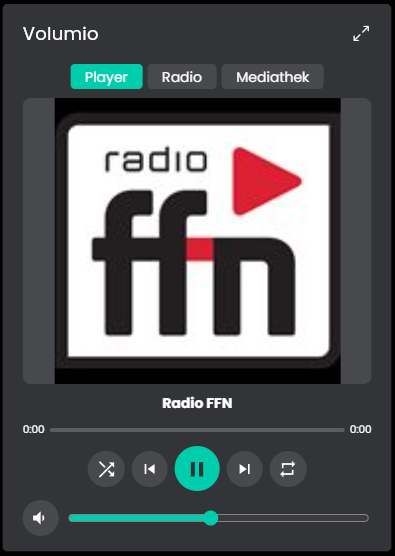
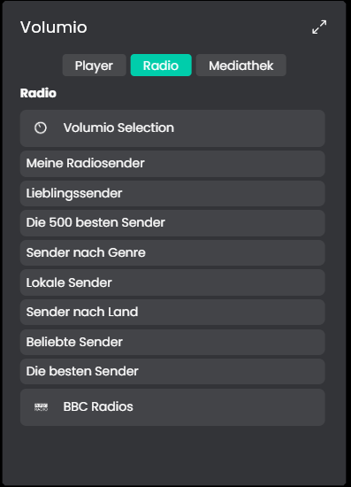
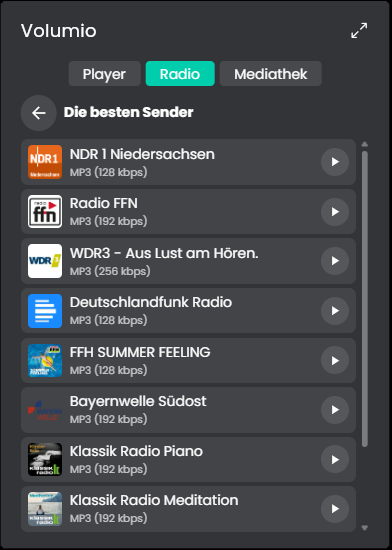
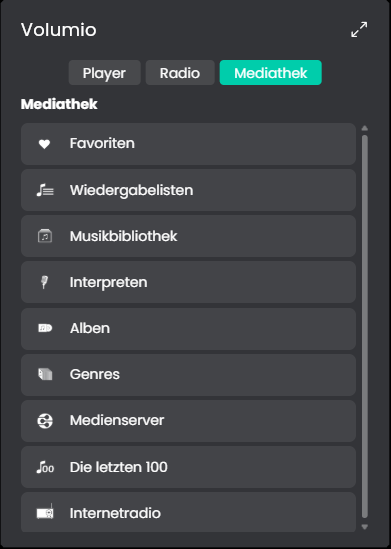

# Volumio
Dieses Modul verbindet Volumio (https://volumio.org/) mit IP-Symcon. Voraussetzung ist das offizielle Volumio-4-Plugin "MQTT Client".

## Inhaltsverzeichnis
- [Volumio](#volumio)
  - [Inhaltsverzeichnis](#inhaltsverzeichnis)
  - [Screenshots](#screenshots)
  - [1. Voraussetzungen](#1-voraussetzungen)
  - [2. Funktionsumfang](#2-funktionsumfang)
  - [3. Enthaltene Module](#3-enthaltene-module)
  - [4. Installation](#4-installation)
  - [5. Konfiguration in IP-Symcon](#5-konfiguration-in-ip-symcon)
  - [6. Spenden](#6-spenden)
  - [7. Lizenz](#7-lizenz)

## Screenshots

Kachel-Visualisierung: Player, Radio (Hauptebene und Kategorie) und Mediathek.

## 1. Voraussetzungen

* mindestens IP-Symcon 9.0
* MQTT Server in IP-Symcon
* Volumio 4 mit dem Plugin "MQTT Client"

## 2. Funktionsumfang

* Wiedergabe steuern, Lautstärke, Stumm, Wiederholen und Zufall
* Titel, Künstler, Album, Cover, Position und Dauer anzeigen
* Radiosender, Wiedergabelisten und Mediathek von Volumio durchsuchen und abspielen
* Kachel-Visualisierung
* Befehle optional an eine Gruppe des Plugins senden

Die einzelnen Funktionen stehen bei den Instanzen unter "Enthaltene Module" und in der README des jeweiligen Moduls.

## 3. Enthaltene Module

* [Volumio](Volumio/README.md)
  * Steuert einen Volumio-Player über MQTT und zeigt seinen Zustand an.
  * Radiosender, Wiedergabelisten und Mediathek über die REST-API von Volumio.
  * Kachel-Visualisierung mit Player, Radio und Mediathek.

## 4. Installation
Die Installation erfolgt über den IP-Symcon Module Store.

## 5. Konfiguration in IP-Symcon
Die Instanz "Volumio" anlegen, den MQTT Server als übergeordnete Instanz verbinden und das MQTT Topic des Players eintragen (`<Basis-Topic>/<Geräte-ID>`). Für Radiosender, Mediathek und Cover zusätzlich den Volumio-Host eintragen. Die Einzelheiten stehen in der README des Moduls.

## 6. Spenden
Dieses Modul ist für die nicht kommerzielle Nutzung kostenlos, Schenkungen als Unterstützung für den Autor werden hier akzeptiert:

 

## 7. Lizenz

[CC BY-NC-SA 4.0](https://creativecommons.org/licenses/by-nc-sa/4.0/)
